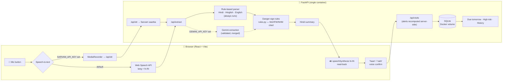

# आशा साथी · ASHA Saathi

### ▶ Live demo: **https://asha-saathi-0csj.onrender.com**
HTTPS, so the microphone works; use Chrome or Edge. No login or keys needed. Press **▶ Try sample** if you have no mic.
*It's hosted on Render's free tier, so after 15 idle minutes the first visit takes about 50 seconds to wake up. The free disk is temporary, so visits you save reset when the instance sleeps or redeploys, and the 5 demo women are re-seeded automatically. For anything persistent, run it locally with `docker compose up`.*

**Voice-first visit register for ASHA workers (called Mitanin in Chhattisgarh).**
She speaks a home visit in Hindi, Hinglish or English. The app fills the register, reads it back in Hindi, saves it when she says "haan", and raises a red alert when it hears a pregnancy danger sign. She never has to type.

> Built for **Scaler × Wispr Flow "Build for Bharat" Round 2**, theme: *Healthcare access*.

---

## The problem

India has ~10 lakh ASHAs. Each one covers about 1,000 people and fills a stack of paper registers (ANC, immunisation, home visits) after every visit, often late at night and often copied twice. Typing on a phone in Hindi is slow and error-prone, so data comes in late or incomplete.

The cost of a late entry is clinical, not clerical. **High BP, bleeding, severe anaemia and reduced fetal movement** are the signs that should get a pregnant woman to a PHC *today*. On paper nobody flags them; the record just sits in a register.

**ASHA Saathi turns a 30-second spoken note into a structured register entry, plus a danger-sign check with reasons.**

## 1-minute demo

1. `docker compose up` → open **http://localhost:8000** (use Chrome or Edge for the microphone).
2. **Language:** the app opens in **हिं + EN** — Hindi as the main text with a smaller English line under every label, button, alert and the read-back summary. Use the header toggle **हिं + EN | हिं | EN** to switch to Hindi-only (an ASHA's everyday view) or English-only (judges). The choice is remembered in the browser (localStorage). The first open is always bilingual; it never guesses from the browser language.
3. Tap **▶ Try sample** (no microphone needed). A Hindi visit note for *रेखा वर्मा* is typed out like live dictation.
4. Watch the fields fill in: month 5, BP 142/92, swelling + headache, IFA yes, Td-2, next visit *kal*.
5. A **red alert** appears: *High BP* + *Pre-eclampsia warning signs*. Each alert says **why** it fired (`BP 142/92 ≥ 140/90`) and **which guideline** it comes from.
6. Under the Hindi transcript, an **English gloss** of the extracted visit appears (built from the extracted fields, so it works offline). The **read-back summary** card shows the Hindi summary with the English one underneath.
7. The app **reads the summary aloud** (Hindi in हिं + EN / हिं, English in EN), then listens about 9 seconds for **"haan" / "nahi"** (or *yes* / *no*, or a correction such as *"बीपी 150 बाय 100"*). If she pauses, it listens once more automatically. Big **हाँ ✓ Yes / नहीं ✗ No** buttons are always shown as a tap fallback.
   - **A pending visit is never lost.** If listening stops, the hint reads *"माइक दबाकर हाँ या नहीं बोलें / Tap mic and say yes or no"*. Tapping the mic then listens **only for the answer** and keeps every extracted field.
   - The visit is also kept in the browser (localStorage), so a **page refresh restores it**. Only a save, or **＋ New visit** (which asks first), clears it.
8. Open **📅 कल (Due)**: Rekha now appears in *due tomorrow*. Open **⚠️ Risk**: she is on the high-risk list.
9. Tap **Try sample** until *Real speech-to-text — unclear BP* comes up. This is the exact text Chrome produced from a real recording, with "150" heard as "15" and कम as काम. The BP field turns amber, nothing is guessed, and the read-back asks for the BP again.
10. With a mic: tap the big button and speak at your own pace. Pauses of up to about 3 seconds to think are fine: the app shows **"सुन रही हूँ… / Listening…"** and keeps listening. Finish by saying **"बस"** or **"हो गया"**, or tap the big **बस ✓ / Done** button. Say something like
   *"Sunita Sahu, saat mahine, BP 150 by 100, pairon mein sujan hai, baby movement kam hai, agle hafte phir aaungi"*.

If something was misheard, tap that field to fix it. Most fields are big tap-buttons (month 1–9, symptoms, dates like कल/परसों), so even corrections rarely need typing.

## Architecture



| Layer | Choice | Why |
|---|---|---|
| Speech-to-text | Browser **Web Speech API** (`hi-IN`) | Free, no key, handles Hindi and Hinglish well in Chrome |
| Extraction | Own **rule-based parser** ([`backend/app/parser.py`](backend/app/parser.py), [`numbers.py`](backend/app/numbers.py)) | Deterministic, testable, works with no key, no per-call cost |
| Clinical logic | [`backend/app/rules.py`](backend/app/rules.py) | Every threshold in one file, each with a citation |
| Read-back | Browser `speechSynthesis` (`hi-IN`, or `en-IN` in EN mode) | Free, on-device |
| Language | Own i18n layer ([`frontend/src/i18n.js`](frontend/src/i18n.js)): **हिं + EN** (default) · **हिं** · **EN** | Hindi-first for ASHAs, readable by anyone. Register fields and danger alerts keep an English line even in Hindi-only mode |
| Backend | FastAPI + SQLite (stdlib `sqlite3`) | One container, one file DB, zero setup |
| Frontend | React 18 + Vite, hand-written CSS | Fast, small bundle (~55 kB gzip), mobile-first |

## Offline mode vs key mode

| | **Offline mode (default, no keys)** | **Key mode (optional)** |
|---|---|---|
| Speech-to-text | Browser Web Speech API, `hi-IN` | `SARVAM_API_KEY` → Sarvam `saarika` server STT (also works in browsers without Web Speech, e.g. Firefox) |
| Field extraction | Rule-based parser | `GEMINI_API_KEY` → Gemini JSON extraction. Each field is validated on its own and merged with the parser; the parser fills any gaps |
| UI badge | `🔌 key not set – offline mode` | `🎙 Sarvam STT · ✨ Gemini + rules` |
| On API error / timeout / quota | — | Falls back to offline mode automatically. The UI shows a note; nothing crashes |

To enable key mode, copy `.env.example` to `.env`, fill in the keys, and run `docker compose up` again. `.env` is git-ignored.

> **Honest note:** in Chrome, Web Speech recognition is processed by Google's speech service, so the *microphone path* needs internet even in "offline mode". "Offline" here means **no API keys, no paid services and no accounts**. Parsing, rules, storage and read-back all run locally. **▶ Try sample** works with no microphone at all.

## Dependencies and fallback plan if a paid API gets costly or stops

| Dependency | Paid? | If it gets expensive or disappears |
|---|---|---|
| Web Speech API (Chrome) | Free | Switch to Sarvam (key), or self-host an open model such as AI4Bharat IndicConformer / Whisper behind the same `/api/stt` endpoint, which the UI already supports |
| Sarvam STT | Paid, optional | Remove the key: the app reverts to browser STT with no code change |
| Gemini | Paid, optional | Remove the key: the rule-based parser already handles the full flow and is covered by 200+ tests, including 35 realistic spoken sentences and real speech-to-text mishearings |
| FastAPI, React, SQLite | Open source | — |

No feature in the core flow depends on a paid API.

## Danger-sign rules and sources

All thresholds are named constants in [`backend/app/rules.py`](backend/app/rules.py). Each one carries a comment with the source document, the PDF page and a short quote, and there are no unexplained numbers. Every alert shows **why** it fired, with the measured value, plus its source. I checked every value against the actual government PDFs on 27 Nov 2026; links go straight to the page.

The referral level follows the 2010 ANC guideline's **Box 7**, which sorts each danger sign into *"Visit FRU"* (🚑 emergency) or *"Visit 24-hour PHC"* (🔴 refer today).

| Rule | Fires when | Action | Source (PDF page) |
|---|---|---|---|
| Severe high BP | **diastolic > 110** mmHg ("imminent eclampsia") | 🚑 FRU now | [SBA p.31](https://nhm.gov.in/images/pdf/programmes/maternal-health/guidelines/sba_guidelines_for_skilled_attendance_at_birth.pdf#page=31), [CHO p.29](https://nhsrcindia.org/sites/default/files/2021-12/Care%20During%20Pregnancy%20and%20Childbirth%20Training%20Manual%20for%20CHO%20at%20AB-HWC.pdf#page=29) |
| Convulsions | fits / झटके / दौरा पड़ा | 🚑 FRU now | [SBA p.42](https://nhm.gov.in/images/pdf/programmes/maternal-health/guidelines/sba_guidelines_for_skilled_attendance_at_birth.pdf#page=42) Box 7, [MCP p.4](https://nhm.gov.in/New_Updates_2018/NHM_Components/Immunization/Guildelines_for_immunization/MCP_Card_English_version.pdf#page=4) |
| Bleeding | any bleeding in pregnancy | 🚑 FRU now | [SBA p.42](https://nhm.gov.in/images/pdf/programmes/maternal-health/guidelines/sba_guidelines_for_skilled_attendance_at_birth.pdf#page=42) Box 7, [MCP p.4](https://nhm.gov.in/New_Updates_2018/NHM_Components/Immunization/Guildelines_for_immunization/MCP_Card_English_version.pdf#page=4) |
| Headache + blurred vision | both present | 🚑 FRU now | [SBA p.42](https://nhm.gov.in/images/pdf/programmes/maternal-health/guidelines/sba_guidelines_for_skilled_attendance_at_birth.pdf#page=42) Box 7, [MCP p.4](https://nhm.gov.in/New_Updates_2018/NHM_Components/Immunization/Guildelines_for_immunization/MCP_Card_English_version.pdf#page=4) |
| Reduced fetal movement | कम / नहीं, from **month 5** (quickening at 18–22 weeks) | 🚑 FRU now | [SBA p.36](https://nhm.gov.in/images/pdf/programmes/maternal-health/guidelines/sba_guidelines_for_skilled_attendance_at_birth.pdf#page=36), [SBA p.42](https://nhm.gov.in/images/pdf/programmes/maternal-health/guidelines/sba_guidelines_for_skilled_attendance_at_birth.pdf#page=42) Box 7 |
| Severe anaemia | Hb **< 7** g/dL | 🚑 FRU now | [SBA p.42](https://nhm.gov.in/images/pdf/programmes/maternal-health/guidelines/sba_guidelines_for_skilled_attendance_at_birth.pdf#page=42) Box 7, [AMB p.56](https://www.nhm.gov.in/New-Update-2025-26/Nutrition/AMB-guidelines/AMB-Abhiyaan-Guidelines.pdf#page=56) |
| High BP in pregnancy | systolic **≥ 140** and/or diastolic **≥ 90** | 🔴 24-h PHC today | [SBA p.31](https://nhm.gov.in/images/pdf/programmes/maternal-health/guidelines/sba_guidelines_for_skilled_attendance_at_birth.pdf#page=31), [CHO p.45](https://nhsrcindia.org/sites/default/files/2021-12/Care%20During%20Pregnancy%20and%20Childbirth%20Training%20Manual%20for%20CHO%20at%20AB-HWC.pdf#page=45) |
| Pre-eclampsia warning | swelling **+** headache or blurred vision | 🔴 24-h PHC today | [SBA p.43](https://nhm.gov.in/images/pdf/programmes/maternal-health/guidelines/sba_guidelines_for_skilled_attendance_at_birth.pdf#page=43) Box 7, [MCP p.4](https://nhm.gov.in/New_Updates_2018/NHM_Components/Immunization/Guildelines_for_immunization/MCP_Card_English_version.pdf#page=4) |
| Face / hand swelling | oedema of face or hands ("abnormal … refer immediately") | 🔴 refer today | [SBA p.31](https://nhm.gov.in/images/pdf/programmes/maternal-health/guidelines/sba_guidelines_for_skilled_attendance_at_birth.pdf#page=31) |
| Breathlessness | reported | 🔴 24-h PHC today | [SBA p.42](https://nhm.gov.in/images/pdf/programmes/maternal-health/guidelines/sba_guidelines_for_skilled_attendance_at_birth.pdf#page=42) Box 7, [MCP p.4](https://nhm.gov.in/New_Updates_2018/NHM_Components/Immunization/Guildelines_for_immunization/MCP_Card_English_version.pdf#page=4) |
| Abdominal pain | reported (Box 7 says "continuous severe"; we over-alert on purpose, since severity can't be graded at home) | 🔴 24-h PHC today | [SBA p.43](https://nhm.gov.in/images/pdf/programmes/maternal-health/guidelines/sba_guidelines_for_skilled_attendance_at_birth.pdf#page=43) Box 7 |
| High fever | temperature **> 100.4 °F (38 °C)** | 🔴 24-h PHC today | [SBA p.43](https://nhm.gov.in/images/pdf/programmes/maternal-health/guidelines/sba_guidelines_for_skilled_attendance_at_birth.pdf#page=43) Box 7, [MCP p.4](https://nhm.gov.in/New_Updates_2018/NHM_Components/Immunization/Guildelines_for_immunization/MCP_Card_English_version.pdf#page=4) |
| Anaemia | Hb **< 11.0** g/dL (1st/3rd trimester) or **< 10.5** (2nd trimester, months 4–6); or weakness with no Hb test | 🟠 watch | [AMB p.56](https://www.nhm.gov.in/New-Update-2025-26/Nutrition/AMB-guidelines/AMB-Abhiyaan-Guidelines.pdf#page=56) (WHO 2024 cut-offs) |
| Fever (not measured) | fever reported, no temperature | 🟠 watch | [MCP p.4](https://nhm.gov.in/New_Updates_2018/NHM_Components/Immunization/Guildelines_for_immunization/MCP_Card_English_version.pdf#page=4) |
| Swelling of feet only | alone ("could be normal"; check BP) | 🟠 check BP | [SBA p.31](https://nhm.gov.in/images/pdf/programmes/maternal-health/guidelines/sba_guidelines_for_skilled_attendance_at_birth.pdf#page=31) |
| Headache only | alone | 🟠 check BP | [SBA p.31](https://nhm.gov.in/images/pdf/programmes/maternal-health/guidelines/sba_guidelines_for_skilled_attendance_at_birth.pdf#page=31) |
| Not taking IFA | from **month 4**: "one Red-IFA tablet for **180 days** starting from the second trimester" | 🟠 watch | [AMB p.50](https://www.nhm.gov.in/New-Update-2025-26/Nutrition/AMB-guidelines/AMB-Abhiyaan-Guidelines.pdf#page=50) |
| BP / movement unclear | spoken but not understood | 🟠 ask again | [SBA p.31](https://nhm.gov.in/images/pdf/programmes/maternal-health/guidelines/sba_guidelines_for_skilled_attendance_at_birth.pdf#page=31) (measure BP at every visit), [SBA p.36](https://nhm.gov.in/images/pdf/programmes/maternal-health/guidelines/sba_guidelines_for_skilled_attendance_at_birth.pdf#page=36) |

**Sources (Government of India, MoHFW). Page numbers are PDF pages as shown by a PDF viewer:**
- **[SBA]** Maternal Health Division, MoHFW, [*Guidelines for Antenatal Care and Skilled Attendance at Birth by ANMs/LHVs/SNs*](https://nhm.gov.in/images/pdf/programmes/maternal-health/guidelines/sba_guidelines_for_skilled_attendance_at_birth.pdf), April 2010.
- **[CHO]** MoHFW / NHSRC, [*Training Manual on Care During Pregnancy and Child Birth for Community Health Officer at Ayushman Bharat – Health and Wellness Centres*](https://nhsrcindia.org/sites/default/files/2021-12/Care%20During%20Pregnancy%20and%20Childbirth%20Training%20Manual%20for%20CHO%20at%20AB-HWC.pdf), 2021.
- **[MCP]** MoHFW & MoWCD, [*Mother and Child Protection Card*](https://nhm.gov.in/New_Updates_2018/NHM_Components/Immunization/Guildelines_for_immunization/MCP_Card_English_version.pdf), 2018 English version. Page 4 is the "danger signs … take the pregnant woman to the hospital immediately" panel.
- **[AMB]** MoHFW, [*Anemia Mukt Bharat Abhiyaan Operational Guidelines*](https://www.nhm.gov.in/New-Update-2025-26/Nutrition/AMB-guidelines/AMB-Abhiyaan-Guidelines.pdf), June 2026. It uses the WHO 2024 haemoglobin cut-offs.

**What the source check changed (27 Nov 2026):**
- *Severe BP:* this was "≥ 160/110". The MoHFW documents define it only as **diastolic above 110** and give no systolic cut-off, so 160 systolic was removed. A reading like 170/100 still raises "High BP — refer today".
- *Anaemia:* this was "< 11" for the whole pregnancy. The current AMB guideline (WHO 2024) uses **< 10.5 in the second trimester**.
- *Fever:* this was "≥ 38 °C". Box 7 says **more than 38 °C**.
- *Referral level:* now follows Box 7. Reduced fetal movement, Hb < 7 and headache with blurred vision are **FRU emergencies**. Breathlessness is its own **24-h PHC** rule.
- *Sources dropped:* the PMSMA guidelines (they list high-risk *categories* but no numbers) and ASHA Module 7 (it covers child health, not pregnancy). The ASHA Module 6 server was unreachable during the check.

⚠️ This is decision **support** for frontline workers, not a diagnosis. Thresholds should be reviewed by the district medical officer before field use.

## What the parser understands

| Field | Examples it handles |
|---|---|
| Numbers | `140`, `१४०`, `एक सौ चालीस`, `ek sau chalis`, `साढ़े नौ` → 9.5, `8 point 5`; context-aware (`goli do` ≠ 2) |
| BP | `140/90`, `140 by 90`, `140 बटा 90`, `बाय`, `बाई`, `ओवर`, `upar 140 neeche 90`, `140 upar 90 neeche`, `ऊपर का 130 नीचे का 85`. **A spoken BP that isn't a valid reading is never guessed and never dropped.** `बीपी 15 बाय 100` (a lost zero), `90 by 140` (reversed) or `बीपी 150` (half missing) becomes **BP unclear**: the field turns amber and shows what was heard, and the read-back says *"बीपी समझ नहीं आया, दोबारा बोलिए / BP not clear, please say again"* |
| Pregnancy month | `सात महीने`, `7 mahine`, `सातवां महीना`, `7th month`, `28 हफ्ते` → 7; ignores `2 mahine baad` |
| Symptoms | सूजन/sujan/swelling (face vs feet), सिर दर्द/sar dard, धुंधला, खून आना/bleeding (but *not* खून की कमी or खून की जांच), सांस फूलना, कमजोरी, बुखार, पेट दर्द, झटके |
| Negation | `सूजन नहीं है`, `koi sujan nahi`, `no bleeding` are ignored, clause by clause |
| Baby movement | `हलचल कम`, `baby movement kam`, `bachcha hil nahi raha`, and `बेबी मूवमेंट काम है` (speech engines write काम for कम) → reduced. `theek hai`, `कम नहीं`, `हिल रहा है` → normal. **Mentioned with neither** (`बेबी मूवमेंट`) → **unclear**: amber, asked again in the read-back, never assumed normal |
| Run-on speech | Browser STT returns no punctuation, so clauses also end at a sentence-final `है`/`hai`. `सूजन नहीं है बुखार है` keeps the fever and drops only the swelling |
| Saying it again | After a read-back that asks for something, she just says it, e.g. *"बीपी 150 बाय 100"*. The answer is merged into the same entry (`/api/extract` with `base`), then read back again. *"हाँ"* saves as is |
| IFA | `आयरन की गोली ले रही`, `iron nahi le rahi`, `IFA ki 30 goli di` |
| Td / TT | `टीडी का दूसरा टीका`, `TT 1`, `pehla teeka`, `booster` |
| Next visit | `कल`, `परसों`, `अगले हफ्ते`, `5 din baad`, `do hafte baad`, `15 तारीख`, weekday names. A bare `कल` counts only with visit words, because `कल से सिर दर्द` means *since yesterday* |
| Name | Matches the beneficiary roster in Devanagari or Roman script, by full or first name |
| Voice confirm | `हाँ`, `haan sahi hai`, `yes`, `save` → yes; `नहीं`, `galat`, `सही नहीं है` → no (negation wins) |

## How to run

```bash
git clone https://github.com/princejsps12-ux/asha-saathi.git
cd asha-saathi
docker compose up          # builds and starts; prints "ASHA Saathi is running → open http://localhost:8000"
```

Run the tests, inside Docker:

```bash
docker compose run --rm app pytest
```

Other useful commands:

- Lint: `docker compose run --rm app ruff check .` (backend); the frontend's `npm run lint` runs inside every build

- After pulling new code: `docker compose up --build`
- Use another port: `PORT=9000 docker compose up`
- Start fresh demo data: tap **↺ Reset demo data** in the app, or `docker compose down -v`
- Local development without Docker: `cd backend && pip install -r requirements.txt && DB_PATH=./asha.db python -m app.serve`, plus `cd frontend && npm install && npm run dev` (Vite proxies `/api` to the backend)

**Requirements:** Docker with Compose v2. No API keys, no Node or Python on the host.

## Tests

**201 pytest cases + 36 frontend (vitest) cases**, all run inside Docker. The pytest suite runs with `docker compose run --rm app pytest`. Every `docker compose build` also runs ESLint (`--max-warnings 0`), the vitest suite and `ruff check`; any lint warning or failing test fails the build:

- `tests/test_stt_mishearings.py`: the **exact Chrome hi-IN output** of a real spoken visit (`…बीपी 15 बाय 100 … बेबी मूवमेंट काम है…`) and other common mishearings: dropped zeros, reversed or half-heard BP, काम/कम, सूजन spellings, बाय/बाई/ओवर/upar-neeche, run-on sentences, no false "BP unclear" for dates, and the voice correction merge.
- `tests/test_corpus.py`: **35 realistic visit notes** as ASHAs actually say them — Hindi, Hinglish, English, Hindi number words (`एक सौ दस बटा सत्तर`, `ek sau bees by assi`, `साढ़े सात महीने`), every BP format, weeks to months, weekdays, `तारीख`, `परसों`, negations. Symptoms are compared as exact sets, so a false alarm fails the test.
- `tests/test_parser.py`: one block per parser rule. Hindi number words, Devanagari digits, every BP format, months/weeks, symptoms with negation, bleeding vs anaemia vs blood test, fetal movement, IFA, Td, every date phrase, Hb/temperature/weight, name matching, and full Hindi and Hinglish sentences.
- `tests/test_rules.py`: every danger rule, including boundary values (139/89 vs 140/90, Hb 6.8/7.0/10.9/11.0, month 4 vs 5), alert ordering, and a check that every rule cites a source.
- `tests/test_api.py`: the end-to-end pipeline, the bilingual output (English gloss, English read-back, Hindi + English alert reasons and actions), a fully English spoken visit, persistence, the due-tomorrow and high-risk lists, validation errors, alerts recomputed server-side, offline status, Sarvam with no key (503, no crash), and Gemini both timing out (falls back to the parser) and succeeding (validated merge).

- `frontend/src/components/RecordView.test.jsx` renders the record screen with speech recognition scripted (including silences) and the API mocked. It covers:
  - **a pause, then a mic tap:** all fields are kept and saved, with no re-dictation
  - **a correction after a timeout:** "बीपी 150 बाय 100" fills the BP in the same visit
  - **a refresh:** the pending visit is restored, then saved, and storage is cleared, including before the server's date has loaded
  - the Yes/No buttons, the longer listening window plus one automatic retry, and **New visit** discarding only after confirmation

  `confirmFlow.test.js` and `pendingVisit.test.js` unit-test the decisions behind this: what a mic tap means, retry on silence, answer and correction handling, and storage expiry, corrupt data and blocked storage.
- `frontend/src/i18n.test.js`: the default is always bilingual (with nothing stored, and with junk stored), the three toggle options, localStorage save/reload (including blocked storage in private mode), what each mode shows (`linesFor`), Hindi/English key parity, matching placeholders, no Devanagari in English strings, and dates in both languages.

## Error handling

- Every error the UI can show is **bilingual and says what to do next**, for example *"सर्वर से कनेक्ट नहीं हो पाया… / Can't reach the server. Is the app running?"*. The UI never shows a raw status code or stack trace.
- The API returns bilingual `detail` messages. Validation errors return a friendly message plus the field names. Unexpected errors are logged on the server and return a generic 500.
- The microphone being blocked or missing, no speech heard, or no internet each get their own message. Without speech recognition, the app falls back to buttons and **Try sample**.
- A missing or failing Sarvam or Gemini key falls back to offline mode automatically.
- A React error boundary catches any rendering crash and shows a calm bilingual screen with a reload button. Saved data lives on the server, so nothing is lost.

## Project structure

```
asha-saathi/
├── docker-compose.yml      one service, one volume, no keys required
├── Dockerfile              node build stage → python runtime serving API + static UI
├── .env.example            optional keys (never commit .env)
├── backend/              (ruff.toml: lint rules)
│   ├── app/
│   │   ├── numbers.py      Hindi/Hinglish number words → digits
│   │   ├── parser.py       spoken note → VisitFields (offline)
│   │   ├── rules.py        ANC danger-sign rules + citations
│   │   ├── summary.py      Hindi + English read-back and English gloss
│   │   ├── integrations.py optional Sarvam STT / Gemini, with fallback
│   │   ├── db.py           SQLite storage + list queries
│   │   ├── seed.py         5 demo beneficiaries + sample sentences
│   │   ├── main.py         FastAPI routes + bilingual error handling
│   │   └── serve.py        entrypoint, prints the app URL
│   └── tests/              201 pytest cases (parser, corpus, STT mishearings, rules, API)
└── frontend/src/
    ├── i18n.js             हिं + EN / हिं / EN modes, all UI strings, localStorage (+ i18n.test.js)
    ├── lang.jsx            <Bi> two-line label and the language toggle
    ├── confirmFlow.js      confirm step: mic-tap meaning, listen + auto-retry, yes/no/correction (+ test)
    ├── pendingVisit.js     unsaved visit kept in localStorage across refreshes (+ test)
    ├── speech.js           Web Speech recognition, Hindi/English TTS, recorder
    ├── components/RecordView.jsx   mic → extract → read-back → confirm → save
    ├── components/FieldsCard.jsx   tap-to-edit register fields
    ├── components/AlertList.jsx    danger alerts with "why" + source
    ├── components/Lists.jsx        beneficiaries, history, due, high-risk
    └── components/Feedback.jsx     bilingual error notes + crash-safe error boundary
```

## Limitations and next steps

- Covers the ANC (pregnancy) visit only. Immunisation, HBNC newborn visits and family planning would follow the same parser-plus-rules pattern.
- New beneficiaries come from the roster (seeded). Voice enrolment is the next feature.
- Data stays in one local SQLite file. Syncing to HMIS/RCH portals would need government API access.
- A PWA with offline caching and Android TTS voices would make it work on low-end phones with patchy network.
