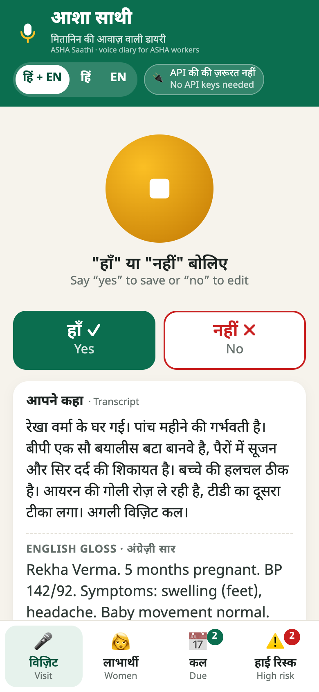
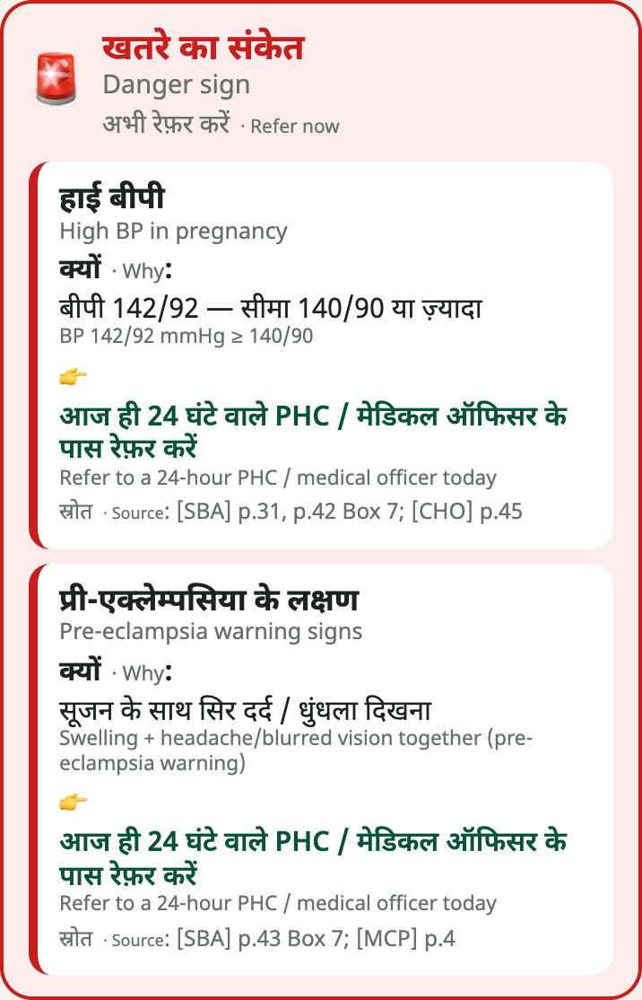
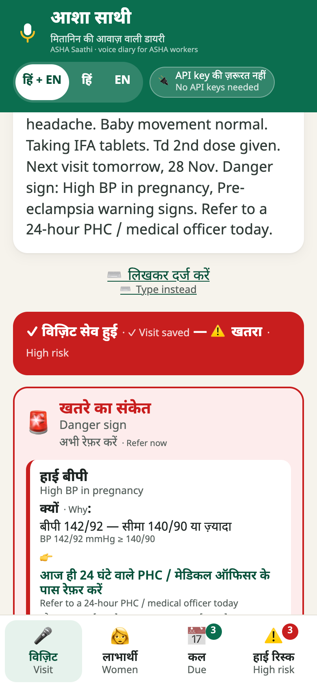
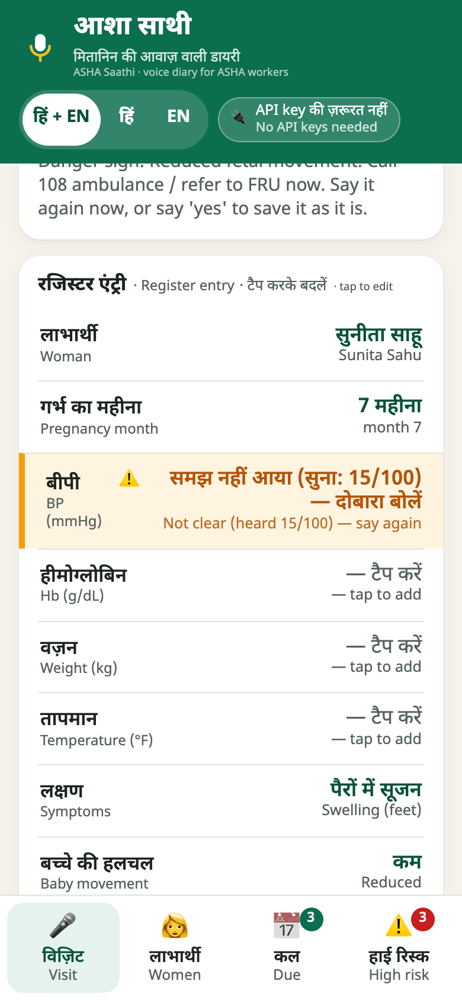
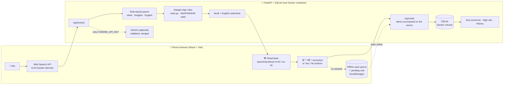

# आशा साथी · ASHA Saathi

[](https://github.com/princejsps12-ux/asha-saathi/actions/workflows/ci.yml)
[](LICENSE)

**A voice-first diary for ASHA / Mitanin workers: she speaks the pregnancy home visit in Hindi, the register fills itself, it is read back aloud, saved when she says "हाँ", and danger signs are flagged on the spot, with the reason. No API keys needed.**

| ▶ Live app | 🎬 Demo video (2:53) | 📑 Pitch deck |
|---|---|---|
| **https://asha-saathi-0csj.onrender.com** | **https://www.youtube.com/watch?v=jMKJgxfqYW4** | **[deck/ASHA-Saathi-Pitch.pdf](deck/ASHA-Saathi-Pitch.pdf)** |

> Built for **Scaler × Wispr Flow "Build for Bharat" Round 2**, theme *Healthcare access*.

## Judge quickstart

Same three commands on every OS — Linux / macOS terminal or Windows PowerShell (each line on its own, so it also works in Windows PowerShell 5.1):

```
git clone https://github.com/princejsps12-ux/asha-saathi.git
cd asha-saathi
docker compose up
```

Wait for `ASHA Saathi is running → open http://localhost:8000` (the first build takes a few minutes; later starts are seconds). Then open **http://localhost:8000** (Chrome or Edge for the microphone).
**No mic? Tap any sample chip** under *▶ नमूना चलाएँ / Try sample*. It runs a real visit note through the whole pipeline: fields, danger alerts, read-back, then tap **हाँ ✓ Yes** to save. Only Docker is needed; no keys, no Node or Python on your machine. Lint and all tests run inside the build.

*The live app is on Render's free tier: after 15 idle minutes the first visit takes about 25–50 s to wake up, and saved visits reset when it sleeps.*

| 1 · Spoken visit → read back | 2 · Danger alert with the reason | 3 · Saved on "हाँ" | 4 · A misheard BP is never guessed |
|---|---|---|---|
|  |  |  |  |

*Real screenshots of the live app at phone size, in the default **हिं + EN** view.*

---

## The problem

We spoke to **3 Mitanin workers in Gharghoda block (Raigarh, Chhattisgarh)**; their names are kept private. They told us:

- they keep **3–4 registers** for every pregnant woman
- paperwork takes **1–2 hours every day**, mostly in the evening or at night
- the **same data is written twice**: in the register and again on the phone
- the **network often fails**, so entries are late

> “वही नाम, वही जानकारी फिर डालो।” — *“The same name, the same details — enter them all again.”*

The cost of a late entry is clinical, not clerical. **High BP, bleeding, severe anaemia and reduced baby movement** are the signs that should get a pregnant woman to a PHC or FRU *today*. On paper nobody flags them at the doorstep.

India has **10.29 lakh ASHAs** (MoHFW Annual Report 2024-25, as on 30 June 2024); Chhattisgarh has **71,000+ Mitanins** (NIC Informatics, Oct 2025). Full sources are in the [pitch deck](deck/ASHA-Saathi-Pitch.pdf), slide 5.

## How it works

1. **Speak the visit** at your own pace: *"सुनीता साहू, सात महीने, बीपी 150 बाय 100, पैरों में सूजन है, बेबी मूवमेंट कम है, अगले हफ्ते फिर आऊंगी"*. Pauses to think are fine; finish by saying **"बस"** / **"हो गया"** or tapping **बस ✓ Done**.
2. **The register fills itself**: woman, month, BP, Hb, weight, temperature, symptoms, baby movement, IFA, Td, next visit date. Every field can be fixed with a tap, mostly with big buttons rather than typing.
3. **Danger-sign check**: each alert says **why** it fired (`BP 150/100 ≥ 140/90`), **what to do** (call 108 / refer to the FRU or a 24-hour PHC) and the **guideline page** it comes from.
4. **Read back aloud** in Hindi (English in EN mode), then the app listens for **"हाँ" / "नहीं"** or a spoken correction (*"बीपी 150 बाय 100"*). Big **हाँ ✓ / नहीं ✗** buttons are always there too.
5. **Saved** on "हाँ"; the **due-tomorrow** and **high-risk** lists and the woman's history update.

**Language:** the screen opens in **हिं + EN**: Hindi first, with a smaller English line under every label, so anyone can review it. The header toggle switches to **हिं** (an ASHA's everyday view) or **EN**. The choice is remembered on the phone. The voice flow is the same in every mode: speech is always recognised as Hindi (which also writes Hinglish and English words), and only the read-back voice follows the toggle.

## Architecture



| Layer | Choice | Why |
|---|---|---|
| Speech-to-text | Browser **Web Speech API** (`hi-IN`) | Free, no key, copes with Hindi and Hinglish in Chrome. Optional: Sarvam server STT with a key |
| Extraction | Our **rule-based parser** ([`parser.py`](backend/app/parser.py), [`numbers.py`](backend/app/numbers.py)) | Deterministic, testable, no key, no per-call cost |
| Clinical logic | [`rules.py`](backend/app/rules.py) | Every threshold in one file, each with a document + page citation |
| Read-back | Browser `speechSynthesis` | Free, on the device |
| Backend | FastAPI + SQLite (stdlib `sqlite3`) | One container, one file database, no setup |
| Frontend | React 18 + Vite, hand-written CSS | Mobile-first, about 65 kB gzipped |

## Safety design

- **Read-back before save.** Nothing is saved until she hears the summary and says "हाँ" (or taps हाँ ✓).
- **Never guesses.** A BP heard as `15 बाय 100`, reversed or half-heard becomes **"बीपी समझ नहीं आया — दोबारा बोलें / BP not clear — say again"**, shows what was heard, and is asked again. Unclear baby movement is asked again, never assumed normal. Two similar names become **"क्या आपका मतलब…? / Did you mean…?"**; an unknown name asks **"नई लाभार्थी जोड़ें? / Add as new woman?"**. A note with no visit details at all (e.g. "hello") is not turned into a visit.
- **Cited rules.** Every threshold is a named constant with the source document and PDF page; every alert shows the reason and the source. See [Danger-sign rules](#danger-sign-rules-and-sources).
- **Server decides.** Alerts are recomputed on the server when a visit is saved; the client's alerts are never trusted.
- **Decision support only.** It refers to a 24-hour PHC or FRU; it does not diagnose.

## Dependencies and fallback

| Dependency | Cost | If it gets costly or stops working |
|---|---|---|
| Browser speech recognition (Chrome) | Free · needs internet | Type-in box, sample chips, and an offline save queue; a server-side STT (Sarvam with a key, or a self-hosted open model) can sit behind the existing `/api/stt` endpoint |
| Our parser + danger rules | Free · our code | Runs fully on our server: no paid AI, no keys. Nothing to switch off |
| Read-back (browser text-to-speech) | Free · on the device | The same summary is always on screen, with big हाँ / नहीं buttons |
| Optional: Sarvam STT, Gemini extraction | Paid · off by default | On error, timeout or no key, it falls back to the built-in parser automatically; the visit still works |
| Hosting: Render free tier (Docker) | Free | One `docker compose up` runs it on any Docker host |

## Honest limits

- **Speech recognition uses the browser and needs internet** (in Chrome it is Google's speech service). **Extraction and danger rules run on our server**, not on the phone, so extracting a visit also needs the network.
- **Offline:** a confirmed visit is kept in an **offline save queue** on the phone and sent automatically when the network returns; words not yet extracted are kept as a draft. The app shell opens offline (service worker).
- Covers the **ANC (pregnancy) home visit** only. Immunisation and newborn visits are next.
- Tested with real Chrome speech output and scripted phone engines; field-tested only through our conversations, not yet in a pilot. Thresholds should be reviewed by the district medical officer before field use.
- The free live demo forgets saved visits when it sleeps. Run it with Docker for persistent data (a Docker volume).

## Tests and code quality

- **284 backend tests (pytest) + 96 frontend tests (vitest)**, all run inside every Docker build, together with **ruff** (lint + format), **ESLint** and **Prettier**. Any warning or failing test fails the build.
- **GitHub Actions CI** runs lint and all tests on every push, then runs `docker compose up` exactly as above and checks the app answers with no keys.
- Highlights: 35 realistic spoken visit notes; the **exact Chrome hi-IN output** of a real recording (BP heard as `15 बाय 100`, कम heard as काम); every danger rule at its boundary values (139/89 vs 140/90, Hb 6.8 / 7.0 / 10.9 / 11.0, month 4 vs 5); the voice flow with pauses, corrections, refresh and offline saves; all three language modes.
- Run them again on their own: `docker compose run --rm test` (backend) and `docker compose run --rm test-web` (frontend).
- Runtime image: Python slim, non-root user, health check, no test tools; exact dependency pins; `npm audit` and `pip-audit` report no known vulnerabilities; no secrets in the repo or its history (gitleaks).

## Roadmap

From what the Mitanins asked for:

- **Done:** saved visit history and the due-tomorrow list; an offline save queue; a Hindi-first, big-text UI with हाँ / नहीं buttons.
- **Next:** check-up and medicine reminders.
- **Next modules:** immunisation and newborn (HBNC) visits.
- **Launch plan:** pilot with Mitanins in Gharghoda block → block PHC / ANM feedback → Raigarh district NHM → the Chhattisgarh state Mitanin programme.

## No-key mode vs key mode

**"No keys"** means: no API keys needed; speech uses the browser's built-in recognition (**needs internet**); extraction and danger rules run fully on our server. Nothing in the core flow needs an account or a paid service.

| | **No-key mode (default)** | **Key mode (optional)** |
|---|---|---|
| Speech-to-text | The browser's built-in recognition (Web Speech API, `hi-IN`) | `SARVAM_API_KEY` → Sarvam `saarika` server STT (also works in browsers without Web Speech, e.g. Firefox) |
| Field extraction + danger rules | Our rule-based parser and `rules.py`, on our server | `GEMINI_API_KEY` → Gemini JSON extraction; each field is validated and merged with the parser, which fills any gaps. Rules are unchanged |
| UI badge | `🔌 API key की ज़रूरत नहीं / No API keys needed`, with the full note in the footer | `🎙 Sarvam STT · ✨ Gemini + rules` |
| On API error / timeout / quota | — | Falls back to the built-in parser automatically. The UI shows a note; nothing crashes |

To enable key mode, copy `.env.example` to `.env`, fill in the keys, and run `docker compose up` again. `.env` is git-ignored.

## Real-world robustness

| Situation | What happens |
|---|---|
| **Network drops** | A confirmed visit is **saved on the phone** (offline queue) and sent when the network returns (on reconnect and every 30 s); a "⏳ N visits waiting to sync" badge shows the count. Words not yet extracted are kept as a **draft** that survives a refresh. The app shell opens with no network. |
| **Server waking up** (free hosting) | After 6 s the screen says the server is waking up; requests wait up to 75 s and retry once. |
| **Browser without speech recognition** (Firefox, some iOS) | *"इस ब्राउज़र में आवाज़ नहीं चलती - Chrome खोलें / Voice not supported here - use Chrome"*; the **type-in** box opens and the **sample chips** stay available. Typed notes go through the same extraction, rules and Yes/No confirm. |
| **Mic blocked / no mic** | When dictating: bilingual guidance (*"tap 🔒 in the address bar and allow the microphone"*) and the type-in box opens. When waiting for "हाँ": a short note, *"माइक नहीं मिला — ऊपर हाँ या नहीं दबाएँ / Mic not available — tap Yes or No above"*. |
| **Nothing understood** | *"विज़िट की कोई जानकारी समझ नहीं आई… / No visit details found — say the name, month, BP and symptoms (or try a sample)"*. No fake woman, no empty read-back. |
| **Pause, refresh, or a late answer** | A pending visit is never lost: a mic tap listens only for the answer and keeps every field; a refresh restores it; only a save or **＋ New visit** (asks first) clears it. |
| **A woman who isn't on the list** | Names are matched across scripts and spellings (सुनिता = सुनीता, Sunitaa Sahoo = Sunita Sahu). Close names become "Did you mean…?" chips; an unknown name offers "Add as new woman?" with the spoken name. |
| **Dialect and noisy speech** | Chhattisgarhi and Bhojpuri symptom words (गोड़ फूल गइल, मूड़ पिरात, लहू, जर, लइका हिलत नइ हे) and negations नइ / नइखे; fillers (उम्म, मतलब, umm) dropped; repeated fragments collapsed. |
| **Bad or huge input** | Every API body is validated (types, ranges, known symptom codes, list sizes); bodies over 64 KB get a bilingual 413 before being read. All errors are bilingual and say what to do next; a crash-safe error boundary means the screen is never blank. |

## Danger-sign rules and sources

All thresholds are named constants in [`backend/app/rules.py`](backend/app/rules.py). Each one carries a comment with the source document, the PDF page and a short quote, and there are no unexplained numbers. Every alert shows **why** it fired, with the measured value, plus its source. I checked every value against the actual government PDFs on 27 Nov 2026; links go straight to the page.

The referral level follows the 2010 ANC guideline's **Box 7**, which sorts each danger sign into *"Visit FRU"* (🚑 emergency) or *"Visit 24-hour PHC"* (🔴 refer today).

| Rule | Fires when | Action | Source (PDF page) |
|---|---|---|---|
| Severe high BP | **diastolic > 110** mmHg ("imminent eclampsia") | 🚑 FRU now | [SBA p.31](https://nhm.gov.in/images/pdf/programmes/maternal-health/guidelines/sba_guidelines_for_skilled_attendance_at_birth.pdf#page=31), [CHO p.29](https://nhsrcindia.org/sites/default/files/2021-12/Care%20During%20Pregnancy%20and%20Childbirth%20Training%20Manual%20for%20CHO%20at%20AB-HWC.pdf#page=29) |
| Convulsions | fits / झटके / दौरा पड़ा | 🚑 FRU now | [SBA p.42](https://nhm.gov.in/images/pdf/programmes/maternal-health/guidelines/sba_guidelines_for_skilled_attendance_at_birth.pdf#page=42) Box 7, [MCP p.4](https://nhm.gov.in/New_Updates_2018/NHM_Components/Immunization/Guildelines_for_immunization/MCP_Card_English_version.pdf#page=4) |
| Bleeding | any bleeding in pregnancy | 🚑 FRU now | [SBA p.42](https://nhm.gov.in/images/pdf/programmes/maternal-health/guidelines/sba_guidelines_for_skilled_attendance_at_birth.pdf#page=42) Box 7, [MCP p.4](https://nhm.gov.in/New_Updates_2018/NHM_Components/Immunization/Guildelines_for_immunization/MCP_Card_English_version.pdf#page=4) |
| Headache + blurred vision | both present | 🚑 FRU now | [SBA p.42](https://nhm.gov.in/images/pdf/programmes/maternal-health/guidelines/sba_guidelines_for_skilled_attendance_at_birth.pdf#page=42) Box 7, [MCP p.4](https://nhm.gov.in/New_Updates_2018/NHM_Components/Immunization/Guildelines_for_immunization/MCP_Card_English_version.pdf#page=4) |
| Reduced fetal movement | कम / नहीं, from **month 5** (quickening at 18–22 weeks) | 🚑 FRU now | [SBA p.36](https://nhm.gov.in/images/pdf/programmes/maternal-health/guidelines/sba_guidelines_for_skilled_attendance_at_birth.pdf#page=36), [SBA p.42](https://nhm.gov.in/images/pdf/programmes/maternal-health/guidelines/sba_guidelines_for_skilled_attendance_at_birth.pdf#page=42) Box 7 |
| Severe anaemia | Hb **< 7** g/dL | 🚑 FRU now | [SBA p.42](https://nhm.gov.in/images/pdf/programmes/maternal-health/guidelines/sba_guidelines_for_skilled_attendance_at_birth.pdf#page=42) Box 7, [AMB p.56](https://www.nhm.gov.in/New-Update-2025-26/Nutrition/AMB-guidelines/AMB-Abhiyaan-Guidelines.pdf#page=56) |
| High BP in pregnancy | systolic **≥ 140** and/or diastolic **≥ 90** | 🔴 24-h PHC today | [SBA p.31](https://nhm.gov.in/images/pdf/programmes/maternal-health/guidelines/sba_guidelines_for_skilled_attendance_at_birth.pdf#page=31), [CHO p.45](https://nhsrcindia.org/sites/default/files/2021-12/Care%20During%20Pregnancy%20and%20Childbirth%20Training%20Manual%20for%20CHO%20at%20AB-HWC.pdf#page=45) |
| Pre-eclampsia warning | swelling **+** headache or blurred vision | 🔴 24-h PHC today | [SBA p.43](https://nhm.gov.in/images/pdf/programmes/maternal-health/guidelines/sba_guidelines_for_skilled_attendance_at_birth.pdf#page=43) Box 7, [MCP p.4](https://nhm.gov.in/New_Updates_2018/NHM_Components/Immunization/Guildelines_for_immunization/MCP_Card_English_version.pdf#page=4) |
| Face / hand swelling | oedema of face or hands ("abnormal … refer immediately") | 🔴 refer today | [SBA p.31](https://nhm.gov.in/images/pdf/programmes/maternal-health/guidelines/sba_guidelines_for_skilled_attendance_at_birth.pdf#page=31) |
| Breathlessness | reported | 🔴 24-h PHC today | [SBA p.42](https://nhm.gov.in/images/pdf/programmes/maternal-health/guidelines/sba_guidelines_for_skilled_attendance_at_birth.pdf#page=42) Box 7, [MCP p.4](https://nhm.gov.in/New_Updates_2018/NHM_Components/Immunization/Guildelines_for_immunization/MCP_Card_English_version.pdf#page=4) |
| Abdominal pain | reported (Box 7 says "continuous severe"; we over-alert on purpose, since severity can't be graded at home) | 🔴 24-h PHC today | [SBA p.43](https://nhm.gov.in/images/pdf/programmes/maternal-health/guidelines/sba_guidelines_for_skilled_attendance_at_birth.pdf#page=43) Box 7 |
| High fever | temperature **> 100.4 °F (38 °C)** | 🔴 24-h PHC today | [SBA p.43](https://nhm.gov.in/images/pdf/programmes/maternal-health/guidelines/sba_guidelines_for_skilled_attendance_at_birth.pdf#page=43) Box 7, [MCP p.4](https://nhm.gov.in/New_Updates_2018/NHM_Components/Immunization/Guildelines_for_immunization/MCP_Card_English_version.pdf#page=4) |
| Anaemia | Hb **< 11.0** g/dL (1st/3rd trimester) or **< 10.5** (2nd trimester, months 4–6); or weakness with no Hb test | 🟠 watch | [AMB p.56](https://www.nhm.gov.in/New-Update-2025-26/Nutrition/AMB-guidelines/AMB-Abhiyaan-Guidelines.pdf#page=56) (WHO 2024 cut-offs) |
| Fever (not measured) | fever reported, no temperature | 🟠 watch | [MCP p.4](https://nhm.gov.in/New_Updates_2018/NHM_Components/Immunization/Guildelines_for_immunization/MCP_Card_English_version.pdf#page=4) |
| Swelling of feet only | alone ("could be normal"; check BP) | 🟠 check BP | [SBA p.31](https://nhm.gov.in/images/pdf/programmes/maternal-health/guidelines/sba_guidelines_for_skilled_attendance_at_birth.pdf#page=31) |
| Headache only | alone | 🟠 check BP | [SBA p.31](https://nhm.gov.in/images/pdf/programmes/maternal-health/guidelines/sba_guidelines_for_skilled_attendance_at_birth.pdf#page=31) |
| Not taking IFA | from **month 4**: "one Red-IFA tablet for **180 days** starting from the second trimester" | 🟠 watch | [AMB p.50](https://www.nhm.gov.in/New-Update-2025-26/Nutrition/AMB-guidelines/AMB-Abhiyaan-Guidelines.pdf#page=50) |
| BP / movement unclear | spoken but not understood | 🟠 ask again | [SBA p.31](https://nhm.gov.in/images/pdf/programmes/maternal-health/guidelines/sba_guidelines_for_skilled_attendance_at_birth.pdf#page=31) (measure BP at every visit), [SBA p.36](https://nhm.gov.in/images/pdf/programmes/maternal-health/guidelines/sba_guidelines_for_skilled_attendance_at_birth.pdf#page=36) |

**Sources (Government of India, MoHFW). Page numbers are PDF pages as shown by a PDF viewer:**
- **[SBA]** Maternal Health Division, MoHFW, [*Guidelines for Antenatal Care and Skilled Attendance at Birth by ANMs/LHVs/SNs*](https://nhm.gov.in/images/pdf/programmes/maternal-health/guidelines/sba_guidelines_for_skilled_attendance_at_birth.pdf), April 2010.
- **[CHO]** MoHFW / NHSRC, [*Training Manual on Care During Pregnancy and Child Birth for Community Health Officer at Ayushman Bharat – Health and Wellness Centres*](https://nhsrcindia.org/sites/default/files/2021-12/Care%20During%20Pregnancy%20and%20Childbirth%20Training%20Manual%20for%20CHO%20at%20AB-HWC.pdf), 2021.
- **[MCP]** MoHFW & MoWCD, [*Mother and Child Protection Card*](https://nhm.gov.in/New_Updates_2018/NHM_Components/Immunization/Guildelines_for_immunization/MCP_Card_English_version.pdf), 2018 English version. Page 4 is the "danger signs … take the pregnant woman to the hospital immediately" panel.
- **[AMB]** MoHFW, [*Anemia Mukt Bharat Abhiyaan Operational Guidelines*](https://www.nhm.gov.in/New-Update-2025-26/Nutrition/AMB-guidelines/AMB-Abhiyaan-Guidelines.pdf), June 2026. It uses the WHO 2024 haemoglobin cut-offs.

**What the source check changed (27 Nov 2026):**
- *Severe BP:* this was "≥ 160/110". The MoHFW documents define it only as **diastolic above 110** and give no systolic cut-off, so 160 systolic was removed. A reading like 170/100 still raises "High BP — refer today".
- *Anaemia:* this was "< 11" for the whole pregnancy. The current AMB guideline (WHO 2024) uses **< 10.5 in the second trimester**.
- *Fever:* this was "≥ 38 °C". Box 7 says **more than 38 °C**.
- *Referral level:* now follows Box 7. Reduced fetal movement, Hb < 7 and headache with blurred vision are **FRU emergencies**. Breathlessness is its own **24-h PHC** rule.
- *Sources dropped:* the PMSMA guidelines (they list high-risk *categories* but no numbers) and ASHA Module 7 (it covers child health, not pregnancy). The ASHA Module 6 server was unreachable during the check.

⚠️ This is decision **support** for frontline workers, not a diagnosis. Thresholds should be reviewed by the district medical officer before field use.

## What the parser understands

| Field | Examples it handles |
|---|---|
| Numbers | `140`, `१४०`, `एक सौ चालीस`, `ek sau chalis`, `साढ़े नौ` → 9.5, `8 point 5`; context-aware (`goli do` ≠ 2) |
| BP | `140/90`, `140 by 90`, `140 बटा 90`, `बाय`, `बाई`, `ओवर`, `upar 140 neeche 90`, `140 upar 90 neeche`, `ऊपर का 130 नीचे का 85`. **A spoken BP that isn't a valid reading is never guessed and never dropped.** `बीपी 15 बाय 100` (a lost zero), `90 by 140` (reversed) or `बीपी 150` (half missing) becomes **BP unclear**: the field turns amber and shows what was heard, and the read-back says *"बीपी समझ नहीं आया, दोबारा बोलिए / BP not clear, please say again"* |
| Pregnancy month | `सात महीने`, `7 mahine`, `सातवां महीना`, `7th month`, `28 हफ्ते` → 7; ignores `2 mahine baad` |
| Symptoms | सूजन/sujan/swelling (face vs feet), सिर दर्द/sar dard, धुंधला, खून आना/bleeding (but *not* खून की कमी or खून की जांच), सांस फूलना, कमजोरी, बुखार, पेट दर्द, झटके |
| Negation | `सूजन नहीं है`, `koi sujan nahi`, `no bleeding` are ignored, clause by clause |
| Baby movement | `हलचल कम`, `baby movement kam`, `bachcha hil nahi raha`, and `बेबी मूवमेंट काम है` (speech engines write काम for कम) → reduced. `theek hai`, `कम नहीं`, `हिल रहा है` → normal. **Mentioned with neither** (`बेबी मूवमेंट`) → **unclear**: amber, asked again in the read-back, never assumed normal |
| Run-on speech | Browser STT returns no punctuation, so clauses also end at a sentence-final `है`/`hai`. `सूजन नहीं है बुखार है` keeps the fever and drops only the swelling |
| Saying it again | After a read-back that asks for something, she just says it, e.g. *"बीपी 150 बाय 100"*. The answer is merged into the same entry (`/api/extract` with `base`), then read back again. *"हाँ"* saves as is |
| IFA | `आयरन की गोली ले रही`, `iron nahi le rahi`, `IFA ki 30 goli di` |
| Td / TT | `टीडी का दूसरा टीका`, `TT 1`, `pehla teeka`, `booster` |
| Next visit | `कल`, `परसों`, `अगले हफ्ते`, `5 din baad`, `do hafte baad`, `15 तारीख`, weekday names. A bare `कल` counts only with visit words, because `कल से सिर दर्द` means *since yesterday* |
| Name | Matches the beneficiary roster in Devanagari or Roman script, by full or first name |
| Voice confirm | `हाँ`, `haan sahi hai`, `yes`, `save` → yes; `नहीं`, `galat`, `सही नहीं है` → no (negation wins) |

## How to run

```
git clone https://github.com/princejsps12-ux/asha-saathi.git
cd asha-saathi
docker compose up
```

`docker compose up` builds the image (lint + all tests run inside the build), starts it and prints `open http://localhost:8000`. Stop it with `Ctrl+C`.

| Task | Linux / macOS (bash, zsh) | Windows PowerShell |
|---|---|---|
| Run the tests again | `docker compose run --rm test` · `docker compose run --rm test-web` | same |
| After pulling new code | `docker compose up --build` | same |
| Use another port | `PORT=9000 docker compose up` | `$env:PORT = "9000"; docker compose up` |
| Fresh demo data | tap **↺ Reset demo data** in the app, or `docker compose down -v` | same |

**Requirements:** Docker with Compose v2 (Docker Desktop on Windows / macOS, Docker Engine on Linux). No API keys, no Node or Python on the host. Line endings are pinned to LF in `.gitattributes`, so a Windows checkout builds the same as Linux.

<details><summary>Without Docker (for development)</summary>

Backend, in one terminal (Python 3.12):

```bash
cd backend
pip install -r requirements-dev.txt
DB_PATH=./asha.db python -m app.serve            # PowerShell: $env:DB_PATH = "./asha.db"; python -m app.serve
```

Frontend, in a second terminal (Node 22):

```bash
cd frontend
npm ci
npm run dev                                      # Vite proxies /api to the backend
```
</details>

## Project structure

```
asha-saathi/
├── docker-compose.yml        app (no keys needed) + optional test services
├── Dockerfile                frontend build+tests → backend tests → slim non-root runtime
├── .github/workflows/ci.yml  lint + all tests + docker compose smoke test on every push
├── .env.example              optional keys (never commit .env)
├── backend/                  FastAPI (ruff.toml, requirements.txt, requirements-dev.txt)
│   ├── app/
│   │   ├── parser.py         spoken note → register fields (names, BP, dates, dialect, negation)
│   │   ├── numbers.py        Hindi / Hinglish number words → digits
│   │   ├── rules.py          ANC danger-sign rules, each with document + page
│   │   ├── summary.py        Hindi + English read-back and English gloss
│   │   ├── integrations.py   optional Sarvam STT / Gemini, with fallback
│   │   ├── db.py · seed.py   SQLite storage, 5 demo women, the sample notes
│   │   ├── main.py           API routes, validation, size limit, bilingual errors
│   │   └── serve.py          entrypoint, prints the app URL
│   └── tests/                284 pytest cases
├── frontend/src/
│   ├── components/RecordView.jsx   mic → extract → read back → confirm → save
│   ├── confirmFlow.js · pendingVisit.js · syncQueue.js   answer handling, unsaved visit, offline queue
│   ├── speech.js · dictation.js · spokenText.js          speech in / out, "बस" to finish, TTS spelling
│   ├── i18n.js · lang.jsx    हिं + EN / हिं / EN, every UI string, <Bi> two-line labels
│   └── *.test.js(x)          96 vitest cases
├── deck/                     pitch deck (HTML → PDF) and the live-app screenshots
└── JUDGE_REVIEW.md           cold-judge review of this repo and what was fixed
```

## License

[MIT](LICENSE) © 2026 Prince Pandey
