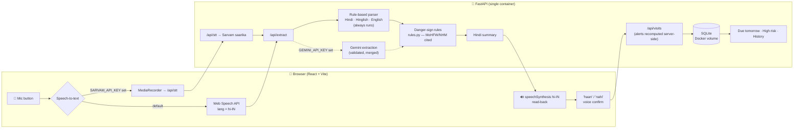

# आशा साथी · ASHA Saathi

**Voice-first visit register for ASHA workers (called Mitanin in Chhattisgarh).**
She speaks a home visit in Hindi, Hinglish or English. The app fills the register, reads it back in Hindi, saves it when she says "haan", and raises a red alert when it hears a pregnancy danger sign. She never has to type.

> Built for **Scaler × Wispr Flow "Build for Bharat" Round 2**, theme: *Healthcare access*.

---

## The problem

India has ~10 lakh ASHAs. Each one covers about 1,000 people and fills a stack of paper registers (ANC, immunisation, home visits) after every visit, often late at night and often copied twice. Typing on a phone in Hindi is slow and error-prone, so data comes in late or incomplete.

The cost of a late entry is clinical, not clerical. **High BP, bleeding, severe anaemia and reduced fetal movement** are the signs that should get a pregnant woman to a PHC *today*. On paper nobody flags them; the record just sits in a register.

**ASHA Saathi turns a 30-second spoken note into a structured register entry, plus a danger-sign check with reasons.**

## 1-minute demo

1. `docker compose up` → open **http://localhost:8000** (use Chrome or Edge for the microphone).
2. **Language:** the app opens in **हिं + EN** — Hindi as the main text with a smaller English line under every label, button, alert and the read-back summary. Use the header toggle **हिं + EN | हिं | EN** to switch to Hindi-only (an ASHA's everyday view) or English-only (judges). The choice is remembered in the browser (localStorage). The first open is always bilingual; it never guesses from the browser language.
3. Tap **▶ Try sample** (no microphone needed). A Hindi visit note for *रेखा वर्मा* is typed out like live dictation.
4. Watch the fields fill in: month 5, BP 142/92, swelling + headache, IFA yes, Td-2, next visit *kal*.
5. A **red alert** appears: *High BP* + *Pre-eclampsia warning signs*. Each alert says **why** it fired (`BP 142/92 ≥ 140/90`) and **which guideline** it comes from.
6. Under the Hindi transcript, an **English gloss** of the extracted visit appears (built from the extracted fields, so it works offline). The **read-back summary** card shows the Hindi summary with the English one underneath.
7. The app **reads the summary aloud** (Hindi in हिं + EN / हिं, English in EN) and listens for **"haan" / "nahi"** (or *yes* / *no*). Say *haan*, or tap **✓ Save**.
8. Open **📅 कल (Due)**: Rekha now appears in *due tomorrow*. Open **⚠️ Risk**: she is on the high-risk list.
9. With a mic: tap the big button and say something like
   *"Sunita Sahu, saat mahine, BP 150 by 100, pairon mein sujan hai, baby movement kam hai, agle hafte phir aaungi"*.

If something was misheard, tap that field to fix it. Most fields are big tap-buttons (month 1–9, symptoms, dates like कल/परसों), so even corrections rarely need typing.

## Architecture



| Layer | Choice | Why |
|---|---|---|
| Speech-to-text | Browser **Web Speech API** (`hi-IN`) | Free, no key, handles Hindi and Hinglish well in Chrome |
| Extraction | Own **rule-based parser** ([`backend/app/parser.py`](backend/app/parser.py), [`numbers.py`](backend/app/numbers.py)) | Deterministic, testable, works with no key, no per-call cost |
| Clinical logic | [`backend/app/rules.py`](backend/app/rules.py) | Every threshold in one file, each with a citation |
| Read-back | Browser `speechSynthesis` (`hi-IN`, or `en-IN` in EN mode) | Free, on-device |
| Language | Own i18n layer ([`frontend/src/i18n.js`](frontend/src/i18n.js)): **हिं + EN** (default) · **हिं** · **EN** | Hindi-first for ASHAs, readable by anyone. Register fields and danger alerts keep an English line even in Hindi-only mode |
| Backend | FastAPI + SQLite (stdlib `sqlite3`) | One container, one file DB, zero setup |
| Frontend | React 18 + Vite, hand-written CSS | Fast, small bundle (~55 kB gzip), mobile-first |

## Offline mode vs key mode

| | **Offline mode (default, no keys)** | **Key mode (optional)** |
|---|---|---|
| Speech-to-text | Browser Web Speech API, `hi-IN` | `SARVAM_API_KEY` → Sarvam `saarika` server STT (also works in browsers without Web Speech, e.g. Firefox) |
| Field extraction | Rule-based parser | `GEMINI_API_KEY` → Gemini JSON extraction. Each field is validated on its own and merged with the parser; the parser fills any gaps |
| UI badge | `🔌 key not set – offline mode` | `🎙 Sarvam STT · ✨ Gemini + rules` |
| On API error / timeout / quota | — | Falls back to offline mode automatically. The UI shows a note; nothing crashes |

To enable key mode, copy `.env.example` to `.env`, fill in the keys, and run `docker compose up` again. `.env` is git-ignored.

> **Honest note:** in Chrome, Web Speech recognition is processed by Google's speech service, so the *microphone path* needs internet even in "offline mode". "Offline" here means **no API keys, no paid services and no accounts**. Parsing, rules, storage and read-back all run locally. **▶ Try sample** works with no microphone at all.

## Dependencies and fallback plan if a paid API gets costly or stops

| Dependency | Paid? | If it gets expensive or disappears |
|---|---|---|
| Web Speech API (Chrome) | Free | Switch to Sarvam (key), or self-host an open model such as AI4Bharat IndicConformer / Whisper behind the same `/api/stt` endpoint, which the UI already supports |
| Sarvam STT | Paid, optional | Remove the key: the app reverts to browser STT with no code change |
| Gemini | Paid, optional | Remove the key: the rule-based parser already handles the full flow and is covered by 150+ tests, including 35 realistic spoken sentences |
| FastAPI, React, SQLite | Open source | — |

No feature in the core flow depends on a paid API.

## Danger-sign rules and sources

All thresholds are named constants in [`backend/app/rules.py`](backend/app/rules.py). Each one has a comment citing its source, and there are no unexplained numbers. Every alert shows **why** it fired, with the measured value.

| Rule | Fires when | Severity | Source |
|---|---|---|---|
| Severe high BP | BP ≥ **160/110** mmHg | 🔴 emergency | [SBA] PIH; [PMSMA] HRP criteria |
| High BP in pregnancy | BP ≥ **140/90** mmHg | 🔴 refer today | [SBA] PIH section |
| Convulsions | fits / झटके / दौरा पड़ा | 🔴 emergency | [MCP]; [SBA] eclampsia |
| Pre-eclampsia warning | swelling **+** headache or blurred vision | 🔴 refer | [MCP] danger signs |
| Face / hand swelling | swelling of face or hands | 🔴 refer | [MCP] |
| Headache + blurred vision | both present | 🔴 refer | [MCP] |
| Bleeding | any vaginal bleeding | 🔴 emergency | [MCP]; [ASHA] Module 7 |
| Reduced fetal movement | movement कम / नहीं, from **month 5** (quickening ≈ 20 weeks) | 🔴 refer | [MCP]; [SBA] |
| Severe anaemia | Hb **< 7** g/dL, or breathlessness | 🔴 refer | [AMB]; [MCP] |
| Abdominal pain | reported (deliberately over-alerts: severity can't be graded at home) | 🔴 refer | [MCP] |
| High fever | temp ≥ **100.4 °F (38 °C)** | 🔴 refer | [MCP]; [SBA] |
| Anaemia | Hb **< 11** g/dL, or weakness/pallor with no Hb | 🟠 watch | [AMB] |
| Fever (not measured) | fever reported, no temperature | 🟠 watch | [MCP] |
| Swelling of feet only | alone | 🟠 check BP | [SBA] |
| Headache only | alone | 🟠 check BP | [SBA] |
| Not taking IFA | from **month 4** (180 tablets advised) | 🟠 watch | [AMB] |

**Sources (Government of India):**
- **[SBA]** MoHFW, *Guidelines for Antenatal Care and Skilled Attendance at Birth by ANMs/LHVs/SNs* (2010)
- **[MCP]** MoHFW, *Mother and Child Protection Card*, "danger signs during pregnancy"
- **[ASHA]** NHM, *ASHA training modules 6 & 7*
- **[AMB]** MoHFW, *Anemia Mukt Bharat — Intensified NIPI Operational Guidelines* (2018)
- **[PMSMA]** MoHFW, *Pradhan Mantri Surakshit Matritva Abhiyan*, high-risk pregnancy criteria

⚠️ This is decision **support** for frontline workers, not a diagnosis. Thresholds should be reviewed by the district medical officer before field use.

## What the parser understands

| Field | Examples it handles |
|---|---|
| Numbers | `140`, `१४०`, `एक सौ चालीस`, `ek sau chalis`, `साढ़े नौ` → 9.5, `8 point 5`; context-aware (`goli do` ≠ 2) |
| BP | `140/90`, `140 by 90`, `140 बटा 90`, `बाय`, `upar 140 neeche 90`, `140 upar 90 neeche`, `ऊपर का 130 नीचे का 85` |
| Pregnancy month | `सात महीने`, `7 mahine`, `सातवां महीना`, `7th month`, `28 हफ्ते` → 7; ignores `2 mahine baad` |
| Symptoms | सूजन/sujan/swelling (face vs feet), सिर दर्द/sar dard, धुंधला, खून आना/bleeding (but *not* खून की कमी or खून की जांच), सांस फूलना, कमजोरी, बुखार, पेट दर्द, झटके |
| Negation | `सूजन नहीं है`, `koi sujan nahi`, `no bleeding` are ignored, clause by clause |
| Baby movement | `हलचल कम`, `baby movement kam`, `bachcha hil nahi raha` → reduced; `theek hai`, `कम नहीं` → normal |
| IFA | `आयरन की गोली ले रही`, `iron nahi le rahi`, `IFA ki 30 goli di` |
| Td / TT | `टीडी का दूसरा टीका`, `TT 1`, `pehla teeka`, `booster` |
| Next visit | `कल`, `परसों`, `अगले हफ्ते`, `5 din baad`, `do hafte baad`, `15 तारीख`, weekday names. A bare `कल` counts only with visit words, because `कल से सिर दर्द` means *since yesterday* |
| Name | Matches the beneficiary roster in Devanagari or Roman script, by full or first name |
| Voice confirm | `हाँ`, `haan sahi hai`, `yes`, `save` → yes; `नहीं`, `galat`, `सही नहीं है` → no (negation wins) |

## How to run

```bash
git clone https://github.com/princejsps12-ux/asha-saathi.git
cd asha-saathi
docker compose up          # builds and starts; prints "ASHA Saathi is running → open http://localhost:8000"
```

Run the tests, inside Docker:

```bash
docker compose run --rm app pytest
```

Other useful commands:

- Lint: `docker compose run --rm app ruff check .` (backend); the frontend's `npm run lint` runs inside every build

- After pulling new code: `docker compose up --build`
- Use another port: `PORT=9000 docker compose up`
- Start fresh demo data: tap **↺ Reset demo data** in the app, or `docker compose down -v`
- Local development without Docker: `cd backend && pip install -r requirements.txt && DB_PATH=./asha.db python -m app.serve`, plus `cd frontend && npm install && npm run dev` (Vite proxies `/api` to the backend)

**Requirements:** Docker with Compose v2. No API keys, no Node or Python on the host.

## Tests

**154 pytest cases + 16 frontend (vitest) cases**, all run inside Docker. The pytest suite runs with `docker compose run --rm app pytest`. Every `docker compose build` also runs ESLint (`--max-warnings 0`), the vitest suite and `ruff check`; any lint warning or failing test fails the build:

- `tests/test_corpus.py`: **35 realistic visit notes** as ASHAs actually say them — Hindi, Hinglish, English, Hindi number words (`एक सौ दस बटा सत्तर`, `ek sau bees by assi`, `साढ़े सात महीने`), every BP format, weeks to months, weekdays, `तारीख`, `परसों`, negations. Symptoms are compared as exact sets, so a false alarm fails the test.
- `tests/test_parser.py`: one block per parser rule. Hindi number words, Devanagari digits, every BP format, months/weeks, symptoms with negation, bleeding vs anaemia vs blood test, fetal movement, IFA, Td, every date phrase, Hb/temperature/weight, name matching, and full Hindi and Hinglish sentences.
- `tests/test_rules.py`: every danger rule, including boundary values (139/89 vs 140/90, Hb 6.8/7.0/10.9/11.0, month 4 vs 5), alert ordering, and a check that every rule cites a source.
- `tests/test_api.py`: the end-to-end pipeline, the bilingual output (English gloss, English read-back, Hindi + English alert reasons and actions), a fully English spoken visit, persistence, the due-tomorrow and high-risk lists, validation errors, alerts recomputed server-side, offline status, Sarvam with no key (503, no crash), and Gemini both timing out (falls back to the parser) and succeeding (validated merge).

- `frontend/src/i18n.test.js`: the default is always bilingual (with nothing stored, and with junk stored), the three toggle options, localStorage save/reload (including blocked storage in private mode), what each mode shows (`linesFor`), Hindi/English key parity, matching placeholders, no Devanagari in English strings, and dates in both languages.

## Error handling

- Every error the UI can show is **bilingual and says what to do next**, for example *"सर्वर से कनेक्ट नहीं हो पाया… / Can't reach the server. Is the app running?"*. The UI never shows a raw status code or stack trace.
- The API returns bilingual `detail` messages. Validation errors return a friendly message plus the field names. Unexpected errors are logged on the server and return a generic 500.
- The microphone being blocked or missing, no speech heard, or no internet each get their own message. Without speech recognition, the app falls back to buttons and **Try sample**.
- A missing or failing Sarvam or Gemini key falls back to offline mode automatically.
- A React error boundary catches any rendering crash and shows a calm bilingual screen with a reload button. Saved data lives on the server, so nothing is lost.

## Project structure

```
asha-saathi/
├── docker-compose.yml      one service, one volume, no keys required
├── Dockerfile              node build stage → python runtime serving API + static UI
├── .env.example            optional keys (never commit .env)
├── backend/              (ruff.toml: lint rules)
│   ├── app/
│   │   ├── numbers.py      Hindi/Hinglish number words → digits
│   │   ├── parser.py       spoken note → VisitFields (offline)
│   │   ├── rules.py        ANC danger-sign rules + citations
│   │   ├── summary.py      Hindi + English read-back and English gloss
│   │   ├── integrations.py optional Sarvam STT / Gemini, with fallback
│   │   ├── db.py           SQLite storage + list queries
│   │   ├── seed.py         5 demo beneficiaries + sample sentences
│   │   ├── main.py         FastAPI routes + bilingual error handling
│   │   └── serve.py        entrypoint, prints the app URL
│   └── tests/              154 pytest cases (parser, 35-sentence corpus, rules, API)
└── frontend/src/
    ├── i18n.js             हिं + EN / हिं / EN modes, all UI strings, localStorage (+ i18n.test.js)
    ├── lang.jsx            <Bi> two-line label and the language toggle
    ├── speech.js           Web Speech recognition, Hindi/English TTS, recorder
    ├── components/RecordView.jsx   mic → extract → read-back → confirm → save
    ├── components/FieldsCard.jsx   tap-to-edit register fields
    ├── components/AlertList.jsx    danger alerts with "why" + source
    ├── components/Lists.jsx        beneficiaries, history, due, high-risk
    └── components/Feedback.jsx     bilingual error notes + crash-safe error boundary
```

## Limitations and next steps

- Covers the ANC (pregnancy) visit only. Immunisation, HBNC newborn visits and family planning would follow the same parser-plus-rules pattern.
- New beneficiaries come from the roster (seeded). Voice enrolment is the next feature.
- Data stays in one local SQLite file. Syncing to HMIS/RCH portals would need government API access.
- A PWA with offline caching and Android TTS voices would make it work on low-end phones with patchy network.
